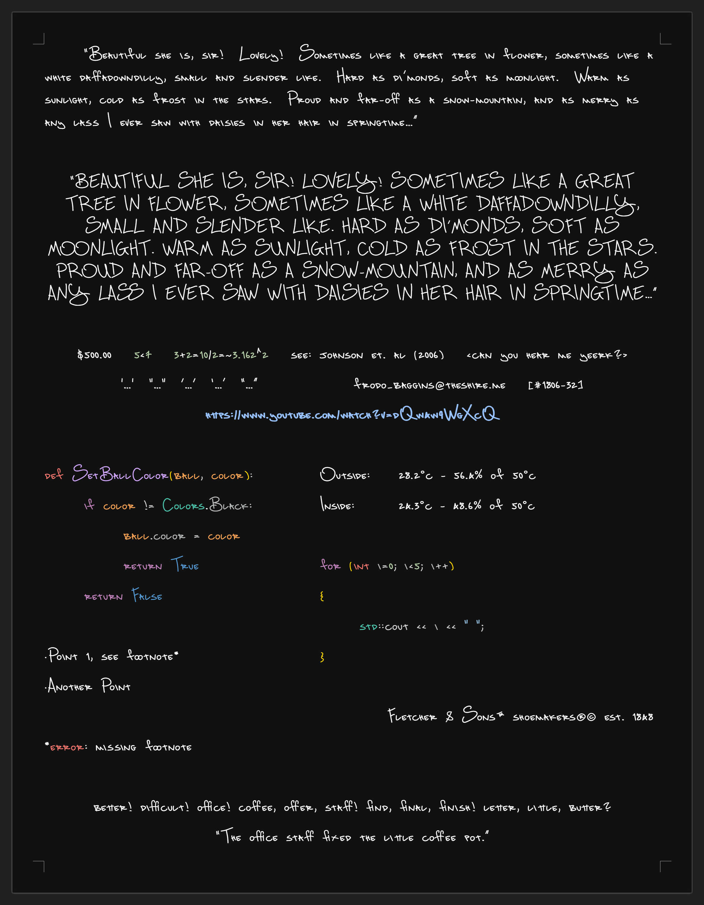

# Unhinged Hand

Unhinged Hand is a handwritten typeface by Dieter "squink" Stassen. It pairs full-height capitals with small caps lowercase letters and comes in one style, Regular.

[Download Unhinged Hand Regular (TTF)](./Unhinged_Hand-Regular.ttf?raw=true)

## Installation

Download the **TTF** and install it with your system's font installer.

## Characters and features

The font includes English uppercase and lowercase letters, digits, punctuation and a bunch of common glyphs. It supports pair kerning and the OpenType ligatures `ff`, `ffi`, `fi`, and `tt`.

It does not support non-english characters and has no natural italic or bold variant.

## License

Copyright © 2026 Dieter "squink" Stassen. The font is available under the [SIL Open Font License 1.1](./OFL.txt). See the [OFL FAQ](https://openfontlicense.org/ofl-faq/) for information on using and redistributing the font.
